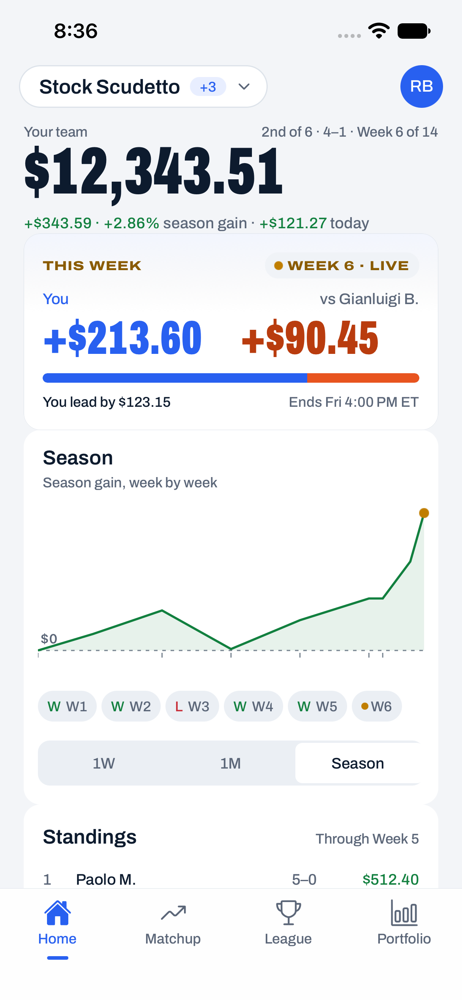

# Stockpile

A fantasy investing app where friends draft real stocks and compete in leagues using simulated money and real market data. Weekly head-to-head matchups turn portfolio performance into standings, playoffs, and season results.

Built by [Giorgio Fatica](https://github.com/giorgiofatica). [Portfolio](https://giorgioportfolio.vercel.app/) · [Public landing page](https://fantasy-stock-app.vercel.app/)

## Current status

**Pre-launch, in closed testing.** React Native is the primary app; the public website is a landing page, and public registration remains closed.

As of **October 22, 2026**, the core league flow includes server-side draft validation, season schedule generation, weekly scoring, standings, and playoffs. The `main` branch carries the 1.3 mobile release work, including the redesigned interface and onboarding. The 1.3 release remains in preparation, with real-device checks and distribution setup outstanding.

The [project status log](docs/STATUS.md) records deployment evidence, release constraints, and remaining work. This README summarizes the project; the status log tracks operations.

## The experience

- **Create a league:** choose a season format, roster size, stock categories, and stake rules, then invite friends.
- **Draft a portfolio:** take turns choosing stocks in a snake draft, with a pick clock, queue, and server-side automatic picks.
- **Compete each week:** compare dollar gains in head-to-head matchups, follow standings, and advance through playoffs. A duration format supports a single longer competition.
- **Manage the season:** make simulated trades, inspect portfolio performance, and retain results across seasons.

No brokerage account or real-money deposit is required. [The design decision behind simulated investing](docs/decisions/DR-001-in-house-simulated-trading.md) explains the scope and tradeoffs.

<details>
<summary>Mobile interface preview</summary>

Development capture with sample league data from the mobile UI review.



</details>

## Technical decisions worth exploring

| Problem | Approach | Where to look |
|---|---|---|
| Drafts and trades must obey league rules even when clients send conflicting requests. | Validate picks on the server and use database transactions for trade recording. | [Draft validation](supabase/functions/validate-and-record-pick/), [trade transaction tests](supabase/tests/record_trade_atomic.pglite.test.ts) |
| Missing market prices or partial snapshots must not silently produce an incomplete score. | Track coverage per participant, retry incomplete work, and refuse scoring when required data is missing. | [Week-start snapshots](supabase/functions/snapshot-week-start/), [week-end snapshots](supabase/functions/snapshot-week-end/), [scoring](supabase/functions/process-week-results/) |
| A database migration can apply successfully while its functions behave incorrectly. | Execute SQL against PGlite test databases and keep separate checks of deployed behavior. | [SQL test guide](supabase/tests/README.md), [deployment evidence](docs/STATUS.md) |
| Documentation can drift from a growing backend. | Generate an architecture map from migrations and client call sites, alongside a dated database snapshot. | [Architecture map and sources](docs/architecture/) |

## Stack and repository layout

| Layer | Technology | Source |
|---|---|---|
| Mobile | React Native, Expo SDK 54, Expo Router, TypeScript | [`apps/mobile/`](apps/mobile/) |
| Web | React, Vite, Tailwind CSS; hosted on Vercel | [`apps/web/`](apps/web/) |
| Shared code | Types, validation, and shared policies | [`packages/shared/`](packages/shared/) |
| Backend | Supabase Auth, Postgres, row-level security, Realtime, Deno Edge Functions | [`supabase/`](supabase/) |
| Market data | Alpaca prices and market calendar; Finnhub company profiles, fetched server-side | [`supabase/functions/`](supabase/functions/) |
| Tooling | Architecture generation and season simulation | [`scripts/`](scripts/) |

## Local development

Use **Node.js 22.13+ on the 22.x line, or Node.js 24.x**, npm, and [Deno](https://deno.com/). The mobile app also needs a compatible simulator or development build. The repository uses [gitleaks](https://github.com/gitleaks/gitleaks) for staged secret scanning.

From the repository root:

```bash
npm ci
brew install gitleaks  # macOS; use the upstream installation guide on other systems
git config core.hooksPath .githooks
```

The mobile app has its own package lock and is installed separately:

```bash
(cd apps/mobile && npm ci)
```

Configure a development Supabase project before starting an app. These examples use placeholders; use only publishable keys in client configuration.

**Web — `apps/web/.env.local`:**

```dotenv
VITE_SUPABASE_URL=your_supabase_url
VITE_SUPABASE_PUBLISHABLE_KEY=your_publishable_key
VITE_HCAPTCHA_SITE_KEY=your_hcaptcha_site_key
```

**Mobile — `apps/mobile/.env`:**

```dotenv
EXPO_PUBLIC_SUPABASE_URL=your_supabase_url
EXPO_PUBLIC_SUPABASE_PUBLISHABLE_KEY=your_publishable_key
```

Backend secrets and data-vendor credentials belong in the server environment. Full backend provisioning and authentication-provider setup are separate from installing the frontend dependencies; see the [documentation index](docs/README.md) and [repo conventions](CLAUDE.md).

Start either frontend from its own directory:

```bash
# Web
(cd apps/web && npm run dev)

# Mobile
(cd apps/mobile && npx expo start)
```

The web app currently has `APP_PAUSED = true` in `apps/web/src/App.jsx`, so its normal entry point shows the landing page. A successful web build alone does not validate the gated application screens. Mobile native integrations require a matching development build; the [simulator guide](docs/testing/MOBILE_SIMULATOR.md) covers the project's fixture-based UI review workflow.

## Testing

The repo includes Deno tests for backend logic, PGlite tests that execute SQL migrations, frontend tests, and device walkthroughs. From the repository root:

```bash
# Backend unit tests
deno test supabase/functions/

# Generated architecture map freshness
node scripts/gen-architecture.mjs --check

# Frontend checks
(cd apps/web && npm run lint && npm run test && npm run typecheck)
(cd apps/mobile && npm run lint && npx tsc --noEmit)
```

See the [SQL test guide](supabase/tests/README.md) for individual database suites and their permissions, and the [1.3 device walkthrough](docs/testing/WALKTHROUGH_1.3.md) for release checks. Season simulations use a configured backend and are documented separately in the [simulation guide](docs/testing/SEASON_SIMULATION_TEST.md).

## Further reading

- [Project status and remaining release work](docs/STATUS.md)
- [Mobile architecture](apps/mobile/ARCHITECTURE.md)
- [Product decisions](docs/PRODUCT_RULES.md) and [decision records](docs/decisions/)
- [Documentation index](docs/README.md)
- [Contributor and operational conventions](CLAUDE.md)

## About this project

An independent product and learning project spanning product design, mobile and web development, relational data modeling, and market-data processing. Development uses AI-assisted tooling, including Claude Code and Codex.
